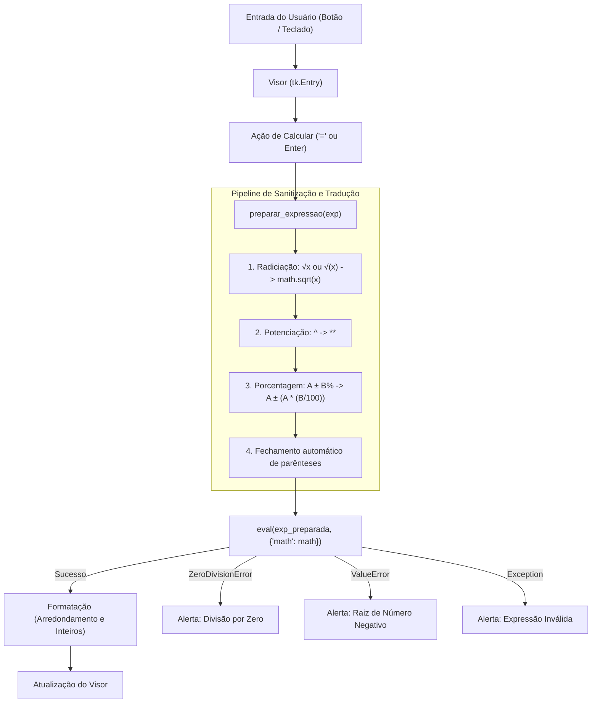

# 🧮 Calculadora Desktop em Python (Tkinter)


Uma aplicação desktop moderna de calculadora com interface escura (*Dark Mode*), desenvolvida em Python nativo com **Tkinter**. Suporta operações aritméticas convencionais, manipulação de expressões com parênteses e operações avançadas como **potenciação**, **radiciação inteligente** e **porcentagem comercial**.

---

## 🚀 Funcionalidades

- **Operações Aritméticas Básicas**: Soma (`+`), Subtração (`-`), Multiplicação (`*`) e Divisão (`/`).
- **Potenciação (`^`)**: Permite potências simples e encadeadas (ex: `2^3` $\rightarrow$ `8`).
- **Radiciação Inteligente (`√`)**:
  - Envolve automaticamente números existentes (ex: digite `25` e aperte `√` para gerar `√(25)`).
  - Suporta abertura de expressões (ex: `√(9) + 4` $\rightarrow$ `7`).
  - Suporta multiplicação implícita (ex: `2√9` $\rightarrow$ `6`).
- **Porcentagem Comercial (`%`)**:
  - **Acréscimos e Descontos**: `100 + 10%` resulta em `110`; `200 - 20%` resulta em `160`.
  - **Percentuais Diretos e Fatores**: `200 * 15%` resulta em `30`; `50%` resulta em `0.5`.
- **Tratamento de Expressões Complexas**: Respeita precedência matemática e parênteses `()`, com fechamento automático de parênteses não balanceados.
- **Segurança Reforçada**: Avaliação de expressões com escopo estritamente isolado (`__builtins__: None` e acesso restrito ao módulo `math`), prevenindo injeção de comandos.
- **Tratamento Robusto de Exceções**: Mensagens amigáveis para divisão por zero, raiz de número negativo e expressões inválidas.
- **Atalho de Teclado**: Suporte para disparar o cálculo teclando `Enter` diretamente no visor.

---

## 🎨 Layout e Organização dos Botões

A interface adota o formato padrão de calculadoras de mesa, com teclado numérico tradicional e coluna lateral de operadores:

```text
+-----------------------------------+
|              [  Visor  ]          |
+---------+---------+---------+-----+
|    C    |    (    |    )    |  /  |
+---------+---------+---------+-----+
|    √    |    ^    |    %    |  *  |
+---------+---------+---------+-----+
|    7    |    8    |    9    |  -  |
+---------+---------+---------+-----+
|    4    |    5    |    6    |  +  |
+---------+---------+---------+-----+
|    1    |    2    |    3    |     |
+---------+---------+---------+  =  |
|        0          |    .    |     |
+-------------------+---------+-----+
```

---

## ⚙️ Arquitetura e Engenharia de Código

O projeto é modular e está concentrado em [calculadora.py](calculadora.py):



---

## 📋 Pré-requisitos

* **Python 3.8+** instalado.
* **Tkinter** (já incluído por padrão nas instalações oficiais do Python para Windows e macOS).
  > No Linux (Ubuntu/Debian), caso não esteja instalado:
  > ```bash
  > sudo apt-get install python3-tk
  > ```

---

## 💻 Como Executar o Projeto

1. Clone este repositório:
   ```bash
   git clone https://github.com/seu-usuario/calculadora-python.git
   cd calculadora-python
   ```

2. Execute o arquivo principal:
   ```bash
   python calculadora.py
   ```

---

## 📦 Como Gerar o Arquivo Executável (`.exe`)

Caso queira distribuir a aplicação para usuários que **não possuem Python instalado**, você pode gerar um executável autônomo utilizando o **PyInstaller**:

1. Instale o PyInstaller:
   ```bash
   pip install pyinstaller
   ```

2. Compile para arquivo único sem janela de terminal:
   ```bash
   pyinstaller --noconsole --onefile calculadora.py
   ```

3. O executável pronto estará na pasta `dist/calculadora.exe`.

---

## 🧪 Casos de Teste Validados

| Operação | Entrada | Expressão Interpretada | Resultado |
| :--- | :--- | :--- | :--- |
| **Potência Simples** | `2^3` | `2**3` | `8` |
| **Potência Encadeada** | `2^3^2` | `2**3**2` | `512` |
| **Radiciação** | `√(16)` ou `√25` | `math.sqrt(16)` ou `math.sqrt(25)` | `4` e `5` |
| **Expressão com Raiz** | `10 + √(4)` | `10 + math.sqrt(4)` | `12` |
| **Multiplicação com Raiz** | `2√9` | `2 * math.sqrt(9)` | `6` |
| **Acréscimo Percentual** | `100 + 10%` | `100 + (100 * (10 / 100))` | `110` |
| **Desconto Percentual** | `200 - 20%` | `200 - (200 * (20 / 100))` | `160` |
| **Percentual Direto** | `50%` | `(50 / 100)` | `0.5` |
| **Fator Percentual** | `200 * 15%` | `200 * (15 / 100)` | `30` |
| **Divisão por Zero** | `10 / 0` | Interceptado por `ZeroDivisionError` | Alerta de Erro |
| **Raiz Negativa** | `√(-9)` | Interceptado por `ValueError` | Alerta de Erro |

---

## 🛠️ Tecnologias Utilizadas

* [Python](https://www.python.org/) - Linguagem de programação.
* [Tkinter](https://docs.python.org/3/library/tkinter.html) - Biblioteca de interface gráfica nativa.
* [Math Module](https://docs.python.org/3/library/math.html) - Funções matemáticas avançadas.
* [Regular Expressions (re)](https://docs.python.org/3/library/re.html) - Mecanismo de parsing e conversão de expressões.

---

## 📄 Licença

Este projeto é de código aberto sob a licença [MIT](LICENSE). Sinta-se à vontade para utilizar, modificar e distribuir.
